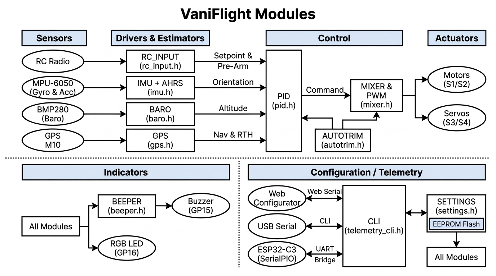

# VaniFlight: Autonomous Flying Wing Flight Controller

> **Nama Proyek:** `VaniFlight` *(Yaufani Flight Controller)*
> **Dokumen:** `README.md`
> **Versi Firmware & Dokumen:** `v0.5.0`
> **Sejak Versi:** `v0.1.0 (2026-10-18)`
> **Terakhir Diperbarui:** `2026-11-25`
> **Dokumentasi Online (GitHub Pages):** [adamyaufani.github.io/vaniflight](https://adamyaufani.github.io/vaniflight/)
> **Web Configurator Online (HTTPS / Web Serial):** [adamyaufani.github.io/vaniflight/configurator](https://adamyaufani.github.io/vaniflight/configurator/)
> **Dokumentasi Wiki Lokal:** [`wiki/Home.md`](wiki/Home.md)
> **Riwayat Perubahan:** [`CHANGELOG.md`](CHANGELOG.md) | **Peta Jalan:** [`ROADMAP.md`](ROADMAP.md)

Proyek *flight controller* mandiri (*zero external core dependencies*) untuk pesawat **Flying Wing**, **Plank**, dan **Tailsitter VTOL** yang dirancang untuk kemudahan modifikasi dan pengembangan sistem otonom.

Satu kode sumber yang sama otomatis mendukung **4 keluarga mikrokontroler** saat kompilasi:
1. **Waveshare RP2040-Zero / Raspberry Pi Pico (RP2040 / RP2350)** *(Board Utama Plane 1 & Plane 2)*
2. **Omnibus F4 V5 (STM32F405) & STM32F411CEU6 "BlackPill"**
3. **ESP32 / ESP32-S3**
4. **Teensy 4.0 / 4.1**

---

## 1. Fitur Utama & Riwayat Kemampuan (`v0.4.3`)

| Fitur | Sejak Versi | File Terkait | Deskripsi Teknis |
| :--- | :---: | :--- | :--- |
| **Madgwick 6-DOF Quaternion AHRS** | `v0.1.0` | [`imu.h`](flying_wing_fc/imu.h) | Estimasi sikap 500 Hz bebas *gimbal lock*, dilengkapi *anti-NaN guard* (`v0.3.0`) & penyelarasan gravitasi instan (`v0.4.1`). |
| **Cascade PID + Turn Assist** | `v0.1.0` | [`pid.h`](flying_wing_fc/pid.h) | *Outer Angle Loop* $\rightarrow$ *Inner Rate Loop*, *Derivative on Measurement*, *D-term LPF*, & fallback otomatis ke Manual bila IMU/Baro putus (`v0.3.0`/`v0.4.1`). |
| **Hardware PWM + Slew Limiter** | `v0.2.0` | [`mixer.h`](flying_wing_fc/mixer.h) | PWM silikon RP2040 50 Hz dengan *Phase-Staggering* & pembatas laju `6 µs/2 ms` anti-*brownout* BEC 5V. |
| **Servo AutoTrim** | `v0.4.0` | [`autotrim.h`](flying_wing_fc/autotrim.h) | Saklar `SwD` (`CH10`) pada mode `ANGLE` untuk memindahkan kompensasi integral PID ke titik tengah servo secara *bumpless* dan menyimpannya ke EEPROM saat *disarm*. |
| **Auto-Level Pitch Trim** | `v0.4.1` | [`autotrim.h`](flying_wing_fc/autotrim.h) | Saklar `SwD` (`CH10`) di Mode `MANUAL`: merekam sudut *Pitch* terbang datar (*cruise AoA*) tervalidasi Barometer & penolak belokan pelan. |
| **Navigasi GPS M10 (UBX/NMEA) & Baro BMP280** | `v0.4.2` | [`gps.h`](flying_wing_fc/gps.h), [`baro.h`](flying_wing_fc/baro.h) | Parser biner *native* u-blox `UBX-NAV-PVT` (`230400` baud, Fletcher-16) + NMEA (`*XX` XOR Checksum), penguncian Home ($\ge 5$ satelit), `MODE_ALT_HOLD`, & `MODE_RTH`. |
| **Non-Blocking Beeper / Buzzer (`GP15`)** | `v0.4.3` | [`beeper.h`](flying_wing_fc/beeper.h) | Indikator suara *state-machine* bebas `delay()` (Boot, GPS Home Lock, Arm/Disarm, Throttle Warning, AutoTrim, & RTH/Lost Model Beacon) untuk buzzer 2-kaki Active/Passive. |
| **EEPROM Flash & CLI Interaktif** | `v0.2.0` | [`settings.h`](flying_wing_fc/settings.h), [`telemetry_cli.h`](flying_wing_fc/telemetry_cli.h) | Konfigurasi *live* via USB Serial Monitor (balik arah servo, kalibrasi, diagnostik GPS/Baro, reboot ke BOOTSEL/DFU tanpa tombol fisik). |

---

## 2. Tabel Wiring (Sambungan Kabel)

> **PENTING (Jalur Daya Servo & BEC ESC):**
> Jangan mengambil listrik 5V untuk menggerakkan Servo dari pin `3.3V` mikrokontroler!
> Sambungkan kabel **Merah (+5V)** dan **Hitam/Coklat (GND)** dari **BEC ESC** langsung ke jalur daya kedua Servo, serta ke pin **5V** dan **GND** pada board mikrokontroler.

### A. Konfigurasi Resmi: Custom PCB "VANIFLIGHT V 1.0" (RP2040-Zero + ESP32-C3)

| Port / Header | Komponen Fisik | Pin RP2040-Zero | Sinyal / Protokol | Keterangan |
| :--- | :--- | :--- | :--- | :--- |
| **S1** | **ESC Motor Kiri / Utama** | **GP14** | Hardware PWM Slice 7A | Motor kiri twin-motor / motor utama single-motor |
| **S2** | **ESC Motor Kanan** | **GP13** | Hardware PWM Slice 6B | Motor kanan twin-motor (*Differential Thrust*) |
| **S3** | **Servo Sayap Kiri (Elevon L)**| **GP3** | Hardware PWM Slice 1B | *Phase-Staggered* (Inverted Polarity 20 ms) |
| **S4** | **Servo Sayap Kanan (Elevon R)**| **GP2**| Hardware PWM Slice 1A | Pulsa normal di awal periode 20 ms |
| **S5** | **Aux 1 / Motor 3 / Flap** | **GP6** | Hardware PWM Slice 3A | Siap pakai untuk 4-motor VTOL / tilt / gimbal |
| **S6** | **Aux 2 / Motor 4 / Rudder**| **GP7** | Hardware PWM Slice 3B | Siap pakai untuk rudder mekanikal / tilt |
| **S7** | **Aux 3 / Gimbal Pan** | **GP11** | Hardware PWM Slice 5B | Channel ekspansi kamera |
| **S8** | **Aux 4 / Gimbal Tilt** | **GP10** | Hardware PWM Slice 5A | Channel ekspansi kamera |
| **AUX Pad** | **Pad Solder Cadangan** | **GP12** | GPIO / PWM Slice 6A | Pad solder serbaguna |
| **IMU** | **GY-521 MPU6050** | **GP4** (SDA) / **GP5** (SCL)| Bus I2C0 (`0x68`) | Daya 3.3V bersih |
| **BARO** | **GY-BMP280** | **GP4** (SDA) / **GP5** (SCL)| Bus I2C0 (`0x76`/`0x77`)| Paralel dengan MPU6050 |
| **GPS** | **RushFPV M10 GPS** | **GP8** (TX) / **GP9** (RX) | UART1 (`230400` baud)| Daya +5V, UBX biner |
| **RX** | **Receiver Serial (SBUS)** | **GP1** (RX) / **GP0** (TX) | UART0 (`100000` 8E2) | Inverter silikon internal aktif otomatis |
| **ESP32** | **ESP32-C3 Super Mini** | **GP28** (RX) / **GP29** (TX)| SerialPIO UART | Link telemetri ESP-NOW tanpa memakan UART0 |
| **BUZZER**| **Active Buzzer 5V** | **GP15** (`+`) / **GND** (`-`) | SIO GPIO 12 mA | Bunyi indikator arming & status |

---

### B. Pilihan 2: Omnibus F4 V5 (STM32F405 Flight Controller)

| Komponen | Koneksi di Omnibus F4 V5 | Keterangan |
| :--- | :--- | :--- |
| **Gyro / Accel** | *(Internal Onboard)* | Otomatis aktif via **SPI1 MPU6000** (`PA4` CS) |
| **ESC Motor Brushless** | Pin **M1** | Timer `PB0` |
| **Servo Sayap Kiri** | Pin **M2** | Timer `PB1` |
| **Servo Sayap Kanan** | Pin **M3** | Timer `PA3` |
| **Receiver ELRS / iBUS / SBUS** | Pad **RX1** (`PA10`) / **J7 SBUS** (`PC7`) | Multi-port scanner aktif |
| **GPS RushFPV M10** | Pad **TX6** (`PC6`) & **RX6** (`PC7`) | Header UART6 |

---

## 3. Pemetaan Channel Remot (FlySky 10CH SBUS / iBUS)

* **CH1**: *Roll* (*Aileron*, kiri dan kanan)
* **CH2**: *Pitch* (*Elevator*, naik dan turun)
* **CH3**: *Throttle* (daya motor)
* **CH4**: *Yaw* (*Rudder*)
* **CH7 (`SwA`, 2 posisi)**: Saklar *Return-to-Home* (`MODE_RTH`), aktif apabila pulsa `> 1700 µs`.
* **CH8 (`SwB`, 2 posisi)**: Saklar *Arm / Disarm* (`< 1500 µs` *disarmed*, `> 1600 µs` *armed*).
  * *Pemeriksaan Pre-Arm*: *Arming* ditolak apabila syarat keamanan belum terpenuhi (`NO_RC`, `THR_HIGH`, `BOOT_SW`, `RTH_SW`, `NO_IMU`, `TILT`, `NO_GPS`), dengan opsi *bypass* untuk `TILT` dan `NO_GPS`.
* **CH9 (`SwC`, 3 posisi)**: Saklar pemilihan mode terbang utama:
  1. Atas (`< 1300 µs`): **MANUAL** (*passthrough* kendali langsung).
  2. Tengah (`1300` hingga `1700 µs`): **ANGLE** (*auto-level*, menjaga sayap kembali datar saat stik dilepas).
  3. Bawah (`> 1700 µs`): **ALT_HOLD** (penguncian ketinggian berbasis barometer BMP280).
* **CH10 (`SwD`, 3 posisi)**: Saklar *AutoTrim* dan *Auto-Level* (`> 1650 µs` aktif):
  * Saat di **`MODE_ANGLE`**: Menjalankan **Servo AutoTrim** (memindahkan kompensasi integral PID ke titik tengah servo secara *bumpless*).
  * Saat di **`MODE_MANUAL`**: Menjalankan **Auto-Level Pitch Trim** (merekam referensi sudut *Pitch* terbang mendatar dengan validasi Barometer).
  * Semua hasil trim langsung bekerja di RAM dan **otomatis disimpan ke Flash EEPROM saat Anda melakukan DISARM (`SwB` OFF)** setelah mendarat.

---

## 4. Perintah Cepat USB Serial Monitor (`115200` Baud)

Ketik huruf berikut lalu tekan **Enter** (semua perintah konfigurasi hanya diizinkan saat **DISARMED** demi keselamatan):
* **`[r]`** : Mode Monitor Receiver & Servo (`10 Hz`)
* **`[p]`** : Mode Grafik Arduino Serial Plotter
* **`[g]`** : Panel Diagnostik Lengkap **Barometer BMP280 & GPS RushFPV M10**
* **`[t]`** : Lihat Status **Servo AutoTrim** (`µs`) & **Auto-Level Trim** (`derajat`)
* **`[c]`** : Kalibrasi Gyro & Titik Datar (*Ground Level Calibration*) di meja rata
* **`[z]`** : Reset semua Trim (Servo & Level) kembali ke `0`
* **`[1]` / `[2]`** : Balik arah (*Reverse*) Servo Kiri / Servo Kanan secara *live*
* **`[a]`** : Toggle *Pre-Arm Bypass* (lewati pemeriksaan GPS 3D dan kemiringan $> 35^\circ$)
* **`[w]`** : Simpan seluruh pengaturan ke **EEPROM Flash Permanen**
* **`[b]`** : Masuk mode **BOOTSEL / DFU** via perangkat lunak tanpa menekan tombol fisik
* **`[e]`** : Aktifkan mode jembatan *USB-to-UART* (`GP28`/`GP29`) untuk memprogram ESP32-C3
* **`[h]`** : Tampilkan banner versi *firmware* dan menu bantuan

---

## 5. Kredit dan Referensi (*Acknowledgments*)

Pengembangan VaniFlight memanfaatkan algoritma terbuka serta terinspirasi oleh berbagai proyek dan pustaka komunitas *open-source* berikut:

* **Sebastian O. H. Madgwick**: Algoritma estimasi sikap 6-DOF *Quaternion AHRS* (*gradient descent orientation filter*) yang diimplementasikan pada [`flying_wing_fc/imu.h`](flying_wing_fc/imu.h).
* **[dRehmFlight](https://github.com/nickrehm/dRehmFlight) (Nicholas Rehm)**: Inspirasi arsitektur *flight controller* berbasis Arduino yang ringkas, mudah dibaca, dan transparan untuk eksperimen *fixed-wing* dan VTOL.
* **[madflight](https://github.com/qqqlab/madflight) (qqqlab)**: Inspirasi struktur pemisahan modul mikrokontroler serbaguna serta penyajian diagram arsitektur subsistem.
* **[INAV](https://github.com/iNavFlight/inav) dan [ArduPilot](https://github.com/ArduPilot/ardupilot)**: Inspirasi konseptual untuk fitur penerbangan *fixed-wing* meliputi *In-Flight AutoTrim*, *Pre-Arm Safety Check* beserta opsi *bypass*, pola *Return-to-Home* (*loiter*), serta tata letak antarmuka koneksi serial.
* **[arduino-pico](https://github.com/earlephilhower/arduino-pico) (Earle F. Philhower, III)**: *Core* RP2040/RP2350, `SerialPIO`, dan antarmuka *Hardware PWM* / EEPROM.
* **[Three.js](https://threejs.org/)**, **[Leaflet](https://leafletjs.com/) / OpenStreetMap**, dan **[Docsify](https://docsify.js.org/)**: Pustaka visualisasi 3D, pemetaan navigasi GPS, dan dokumentasi web pada GitHub Pages.
