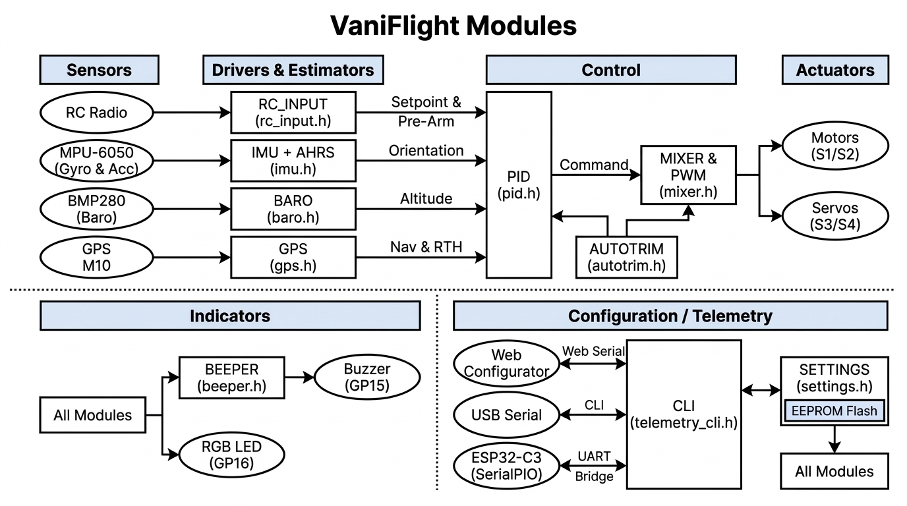

# Dokumentasi Teknis VaniFlight

**VaniFlight** adalah sistem *flight controller* dan antarmuka konfigurasi berbasis web (*Web Configurator*) bersifat *open-source* yang dikembangkan untuk pesawat sayap tetap jenis *flying wing*, *plank*, dan *tailsitter* VTOL. Implementasi utamanya menggunakan mikrokontroler **Waveshare RP2040-Zero** (kompatibel pin dengan **RP2350-Zero**) serta mendukung kompilasi untuk arsitektur STM32F4, ESP32, dan Teensy.

Seluruh modul kendali inti ditulis secara mandiri tanpa ketergantungan pustaka eksternal untuk estimasi sikap, kendali PID, pembacaan sensor, maupun pembangkitan sinyal PWM.

---

## Arsitektur Modul VaniFlight

---

## Daftar Isi Wiki

1. **[Perangkat Keras dan Pengkabelan](Hardware-and-Wiring.md)**
   Daftar komponen (*Bill of Materials*), pemetaan pin PCB **VANIFLIGHT V1.0**, konvensi orientasi sensor MPU-6050, konfigurasi jalur daya BEC/OPTO ESC, dan jalur ekspansi sensor tambahan.
2. **[Kompilasi dan Pemrograman Firmware](Firmware-Flashing-and-Setup.md)**
   Pengaturan lingkungan pengembangan Arduino/CLI, prosedur kompilasi dan pengunggahan *firmware* ke RP2040-Zero, serta mekanisme jembatan serial (*SerialPIO passthrough*) untuk memprogram modul ESP32-C3.
3. **[Panduan Web Configurator dan CLI](Web-Configurator-Guide.md)**
   Prosedur menjalankan Web Configurator melalui Web Serial API, fungsi panel koneksi port serial, deskripsi lima tab pemantauan, serta daftar perintah antarmuka baris perintah (CLI).
4. **[Pengaturan Radio, Receiver, dan OpenTX / OpenI6X](Radio-and-OpenTX-Setup.md)**
   Konfigurasi pemasangan *receiver* FlySky FS-iA6B dan FS-iA6C, pemetaan kanal kendali dan sakelar standar, serta prosedur pengaturan pada pemancar dengan *firmware* OpenI6X atau OpenTX.
5. **[Prosedur Pengecekan Pra-Terbang, Mode Terbang, dan Keamanan](Pre-Flight-and-Safety-Checks.md)**
   Urutan verifikasi mekanis dan sensor sebelum penerbangan perdana, spesifikasi mode terbang, mekanisme *auto-trim* di udara, indikator status, serta aturan pemeriksaan keamanan sebelum *arming* (*pre-arm check*).
6. **[Pemecahan Masalah dan Pertanyaan Umum](Troubleshooting-and-FAQ.md)**
   Panduan diagnosis terhadap kendala teknis yang umum ditemukan selama perakitan, pengujian di meja, dan pengujian terbang.

---

## Ringkasan Spesifikasi Teknis (`v0.5.0`)

| Subsistem | Spesifikasi Implementasi |
| :--- | :--- |
| **Mikrokontroler Utama** | Waveshare RP2040-Zero (Dual-Core ARM Cortex-M0+ 133 MHz, 2 MB Flash, 264 KB SRAM); mendukung target STM32F4, ESP32, dan Teensy |
| **Estimasi Sikap (AHRS)** | Sensor IMU MPU-6050 melalui I2C0 (400 kHz) dengan filter **Madgwick 6-DOF Quaternion** pada frekuensi 500 Hz |
| **Sensor Navigasi** | Barometer BMP280 (`0x76` atau `0x77`) pada I2C0 dan penerima GPS u-blox M10 (protokol biner `UBX-NAV-PVT` 230400 baud serta NMEA *auto-baud*) |
| **Keluaran Aktuator** | Hardware PWM 50 Hz (`S1` hingga `S8`) dengan *phase-staggering*, *slew-rate limiter* (`6 µs / 2 ms`), dan dukungan *differential thrust* |
| **Penerima RC** | Dukungan protokol SBUS (dengan inverter perangkat keras internal RP2040), iBUS, CRSF, dan PPM, dilengkapi pemindaian otomatis antara SBUS dan iBUS |
| **Jalur Telemetri** | Antarmuka `SerialPIO` (`GP28` dan `GP29`) untuk modul ESP32-C3, dilengkapi mode jembatan *USB-to-UART passthrough* |
| **Antarmuka Konfigurasi** | VaniFlight Web Configurator berbasis Web Serial API, Three.js, dan Leaflet yang dapat diakses melalui peramban Chrome, Edge, atau Brave |
